# CareerVault — Ledger di Carriera & Single Source of Truth

[Italiano](README.it.md) · [English](README.md) · [Architettura](docs/ARCHITECTURE.md) · [Lancio e SEO](docs/LAUNCH.md)

[](LICENSE)
[](https://github.com/MRJonam91/CareerVault/actions/workflows/ci.yml)
[](package.json)
[](package.json)
[](https://github.com/sponsors/MRJonam91)

Ledger deterministico della carriera e single source of truth: valida la cronologia professionale, individua anomalie nel CV ed esporta curriculum Markdown verificabili in italiano e inglese e in formato JSON Resume.

<p align="center">
  
</p>

---

## 🎯 Il Problema

Curriculum vitae, portfolio, profili LinkedIn e candidature si disallineano progressivamente nel tempo, generando narrazioni di carriera incoerenti o prive di riscontri oggettivi:
- **Date incoerenti e sovrapposizioni non chiarite**: Ruoli a tempo pieno contemporanei senza menzione di contratti paralleli o date discordanti tra diverse versioni del CV.
- **Discrepanze sulle competenze**: Tecnologie citate nelle mansioni che non compaiono nell'inventario delle skill, o buzzword prive di esperienza documentata.
- **Perdita di metriche e riscontri**: Risultati quantitativi (latenze ridotte, budget ottimizzati) ed evidenze pubbliche verificabili (brevetti, pubblicazioni, pull request open source) vanno persi nei continui copia-incolla manuali.
- **Attrito nella gestione bilingue**: Mantenere versioni separate in italiano e inglese porta inevitabilmente a dimenticare aggiornamenti in una delle due lingue.

---

## 🛡️ La Soluzione: CareerVault

CareerVault struttura la tua carriera in un unico **Single Source of Truth** verificabile e rigoroso (`career.json`):
- **Ledger di Carriera Deterministico**: Schema JSON completo comprendente anagrafica, timeline delle esperienze, evidenze, metriche, formazione, certificazioni e competenze linguistiche.
- **Motore di Rilevamento Anomalie e Incoerenze**:
  - Blocca inversioni cronologiche (`endDate < startDate`).
  - Segnala sovrapposizioni tra contratti a tempo pieno (`full-time`) a meno che non sia specificato `isConcurrent: true`.
  - Controlla la coerenza delle skill (competenze citate nei progetti ma non censite, o skill orfane).
  - Verifica la completezza bilingue (campi mancanti in italiano o inglese).
- **Esportatore Markdown Bilingue**: Genera curriculum Markdown eleganti, deterministici e pronti per la pubblicazione o per la conversione in PDF sia in italiano (`--lang it`) che in inglese (`--lang en`).
- **Esportatore Standard JSON Resume**: Converte nativamente il profilo nello standard universale [JSON Resume](https://jsonresume.org) (`resume.json`).
- **Telemetria di Carriera e Metriche Deduplicate**: Calcola l'anzianità lavorativa effettiva unificando i periodi sovrapposti per evitare doppi conteggi, e misura la percentuale di copertura delle evidenze.
- **Zero Dipendenze di Runtime**: Realizzato in puro TypeScript per Node.js 22/24 usando esclusivamente le API native.

---

## 🚀 Avvio rapido​‌​​‌‌​‌​‌​‌​​‌​​‌​​‌​‌​​​‌‌‌​​‌​​‌‌​​​‌​​‌​‌‌​‌​‌‌​​​‌‌​‌‌‌​‌‌​​​‌​‌‌​‌​‌‌​​‌​‌​​‌‌​‌‌‌​‌‌​​​‌​​​‌‌​​‌‌​‌‌​​​​‌​​‌‌‌​​‌

```bash
# 1. Inizializza un nuovo profilo di carriera
npx careervault init career.json

# 2. Verifica e valida il profilo
npx careervault validate career.json

# 3. Esporta il CV in Markdown in italiano
npx careervault export career.json --lang it --format md --out cv-italiano.md

# 4. Esporta il CV in Markdown in inglese
npx careervault export career.json --lang en --format md --out cv-english.md

# 5. Esporta nello standard JSON Resume
npx careervault export career.json --format json-resume --out resume.json

# 6. Visualizza statistiche di carriera ed evidenze
npx careervault stats career.json
```

---

## 📦 Guida comandi CLI

### 1. `careervault init [path]`
Genera un profilo di partenza con esempi realistici bilingui, metriche e collegamenti di verifica:
```bash
careervault init my-career.json
```

### 2. `careervault validate <file> [--json]`
Effettua l'audit del file individuando errori bloccanti, discrepanze cronologiche e avvisi:
```bash
careervault validate career.json
```

### 3. `careervault export <file> [--lang it|en] [--format md|json-resume] [--out <dest>]`
Esporta il CV strutturato nella lingua e formato desiderati:
```bash
# CV Markdown in italiano
careervault export career.json --lang it --format md -o dist/cv-it.md

# CV Markdown in inglese
careervault export career.json --lang en --format md -o dist/cv-en.md

# Standard JSON Resume
careervault export career.json --format json-resume -o dist/resume.json
```

### 4. `careervault stats <file> [--json]`
Calcola la durata di carriera reale (deduplicando le sovrapposizioni temporali), la ripartizione per categoria di competenze e il livello di copertura delle evidenze:
```bash
careervault stats career.json
```

---

## 💻 Utilizzo Programmabile (Libreria TS/JS)

CareerVault può essere importato direttamente nei tuoi script o progetti:

```typescript
import {
  validateProfile,
  exportMarkdownCv,
  exportJsonResume,
  getCareerStats,
  type CareerProfile
} from "careervault";

// Validazione
const result = validateProfile(myProfile);
if (!result.valid) {
  console.error("Anomalie rilevate:", result.errors);
}

// Esportazione CV italiano e inglese
const italianCv = exportMarkdownCv(myProfile, { lang: "it" });
const englishCv = exportMarkdownCv(myProfile, { lang: "en" });

// Calcolo esperienza deduplicata
const stats = getCareerStats(myProfile);
console.log(`Esperienza totale: ${stats.totalExperienceFormatted.it}`);
```

---

## ☕ Supporto e Donazioni

Se CareerVault ti aiuta a mantenere ordinata la tua storia professionale, prevenire incongruenze o preparare candidature di successo, considera una donazione a supporto dello sviluppo continuo:

[](https://github.com/sponsors/MRJonam91)
[](https://ko-fi.com/mrjonam)
[](https://buymeacoffee.com/mrjonam)
[](https://paypal.me/manorollo)

---

## 📄 Licenza

Codice: **Apache-2.0** — vedi [LICENSE](LICENSE) e [NOTICE](NOTICE) (attribuzione obbligatoria).  
Documentazione: **CC BY-SA 4.0**.  
Contributi via **DCO** (`git commit -s`).  

© 2026 Manoj Rollo (MRJonam91)
