# CareerVault — Career Ledger & Single Source of Truth

[Italiano](README.it.md) · [English](README.md) · [Architecture](docs/ARCHITECTURE.md) · [Launch & SEO](docs/LAUNCH.md)

[](LICENSE)
[](https://github.com/MRJonam91/CareerVault/actions/workflows/ci.yml)
[](package.json)
[](package.json)
[](https://github.com/sponsors/MRJonam91)

Deterministic career ledger and single source of truth: validate career histories, detect CV anomalies, and export verifiable Italian & English Markdown résumés and standard JSON Resume format.

<p align="center">
  
</p>

---

## 🎯 The Problem

Résumés, portfolios, LinkedIn profiles, and job applications drift apart over time, creating conflicting or unverifiable career narratives:
- **Inconsistent Dates & Overlaps**: Conflicting start/end dates across different CV versions and unexplained concurrent full-time roles.
- **Skill Discrepancies**: Technologies claimed in job descriptions that don't match the actual skill inventory, or buzzwords listed without demonstrated experience.
- **Lost Metrics & Evidence**: Quantitative business impact (latencies reduced, revenues increased) and verifiable public evidence (patents, papers, open source PRs) get lost during manual formatting.
- **Translation Friction**: Maintaining separate Italian and English CVs inevitably leads to one language falling behind or missing key achievements.

---

## 🛡️ The Solution: CareerVault

CareerVault transforms your career into a structured, validated, verifiable **Single Source of Truth** (`career.json`):
- **Deterministic Career Ledger**: Comprehensive schema covering contact information, chronological work experience, verifiable achievements, metrics, education, certifications, and language proficiencies.
- **Anomaly & Inconsistency Engine**:
  - Catches chronological errors (`endDate < startDate`).
  - Flags conflicting full-time employment overlaps unless marked `isConcurrent: true`.
  - Audits skill coherence (detects unreferenced skills and orphan declarations).
  - Verifies bilingual completeness (identifies missing Italian or English translations).
- **Dual-Language Markdown Résumé Generator**: Produces clean, elegant, human-readable Markdown CVs in both Italian (`--lang it`) and English (`--lang en`), ready for reading, publishing, or converting to PDF.
- **JSON Resume Standard Exporter**: Converts your career ledger to the universal [JSON Resume](https://jsonresume.org) standard (`resume.json`).
- **Career Telemetry & Deduplicated Metrics**: Computes true career duration by merging overlapping intervals, measures skill category distributions, and tracks verifiable evidence ratios.
- **Zero Runtime Dependencies**: Pure TypeScript running natively on Node.js 22/24 using standard built-ins.

---

## 🚀 Quick start​‌​​‌‌​‌​‌​‌​​‌​​‌​​‌​‌​​​‌‌‌​​‌​​‌‌​​​‌​​‌​‌‌​‌​‌‌​​​‌‌​‌‌‌​‌‌​​​‌​‌‌​‌​‌‌​​‌​‌​​‌‌​‌‌‌​‌‌​​​‌​​​‌‌​​‌‌​‌‌​​​​‌​​‌‌‌​​‌

```bash
# 1. Initialize a new career profile
npx careervault init career.json

# 2. Audit and validate your career profile
npx careervault validate career.json

# 3. Export Italian Markdown CV
npx careervault export career.json --lang it --format md --out cv-italiano.md

# 4. Export English Markdown CV
npx careervault export career.json --lang en --format md --out cv-english.md

# 5. Export JSON Resume standard format
npx careervault export career.json --format json-resume --out resume.json

# 6. Display career telemetry and evidence coverage
npx careervault stats career.json
```

---

## 📦 CLI Usage Guide

### 1. `careervault init [path]`
Generates a starter career profile populated with realistic bilingual entries, schema versioning, metric structures, and evidence links:
```bash
careervault init my-career.json
```

### 2. `careervault validate <file> [--json]`
Audits your profile for schema compliance, chronological errors, and career anomalies:
```bash
careervault validate career.json
```
Output:
```text
Auditing career profile: career.json
──────────────────────────────────────────────────
✅ Profile structure is valid! (0 blocking errors, 1 warning)
  • [MISSING_EVIDENCE] experiences[1].evidence: No verifiable proof attached to 'CloudWave Solutions'
```

### 3. `careervault export <file> [--lang it|en] [--format md|json-resume] [--out <dest>]`
Generates deterministic resumes tailored to your target audience:
```bash
# Italian Markdown CV
careervault export career.json --lang it --format md -o dist/cv-it.md

# English Markdown CV
careervault export career.json --lang en --format md -o dist/cv-en.md

# JSON Resume (schema.org compatible)
careervault export career.json --format json-resume -o dist/resume.json
```

### 4. `careervault diff <old.json> <new.json> [--json]`
Compares two career ledgers and displays an audit trail of changes (added/removed/modified roles, dates, metrics, skills):
```bash
careervault diff career-2024.json career-2026.json
```

### 5. `careervault import <resume.json> [-o <career.json>]`
Imports an existing [JSON Resume](https://jsonresume.org) file and converts it into a structured CareerVault ledger:
```bash
careervault import resume.json -o career.json
```

### 6. `careervault anonymize <file> [-o <career.blind.json>]`
Generates a blind-screening version with personal data (PII) and company names redacted:
```bash
careervault anonymize career.json -o career.blind.json
careervault export career.json --anonymize --lang en -o blind-resume.md
```

### 7. `careervault stats <file> [--json]`
Calculates true career longevity (deduplicating overlapping tenures), skill density, and verification coverage:
```bash
careervault stats career.json
```
Output:
```text
Career Telemetry: Alex Rossi
──────────────────────────────────────────────────
Total Career Duration:  8 years and 2 months (98 months deduplicated)
Total Roles Held:       3 (1 currently active)
Skills Inventory:       12 skills across 4 categories
  • languages: 3
  • frameworks: 4
  • cloud-devops: 3
  • databases: 2
Evidence Coverage:      67% (roles with verifiable anchors)
Bilingual Completeness: 100% (fields available in IT & EN)
```

---

## 💻 Programmatic API

CareerVault can be used as a library in any TypeScript or Node.js project:

```typescript
import {
  validateProfile,
  exportMarkdownCv,
  exportJsonResume,
  getCareerStats,
  type CareerProfile
} from "careervault";

// Validate
const result = validateProfile(myProfile);
if (!result.valid) {
  console.error("Anomalies found:", result.errors);
}

// Generate Italian and English CVs
const italianCv = exportMarkdownCv(myProfile, { lang: "it" });
const englishCv = exportMarkdownCv(myProfile, { lang: "en" });

// Calculate deduplicated career duration
const telemetry = getCareerStats(myProfile);
console.log(`Total experience: ${telemetry.totalExperienceFormatted.en}`);
```

---

## ☕ Support & Donations

If CareerVault helps you organize your career history, detect inconsistencies, or land your next role, please consider supporting development. Every contribution keeps the project independent and free:

[](https://github.com/sponsors/MRJonam91)
[](https://ko-fi.com/mrjonam)
[](https://buymeacoffee.com/mrjonam)
[](https://paypal.me/manorollo)

---

## 📄 License

Code: **Apache-2.0** — see [LICENSE](LICENSE) and [NOTICE](NOTICE) (attribution required).  
Documentation: **CC BY-SA 4.0**.  
Contributions use the **DCO** (`git commit -s`).  

© 2026 Manoj Rollo (MRJonam91)
